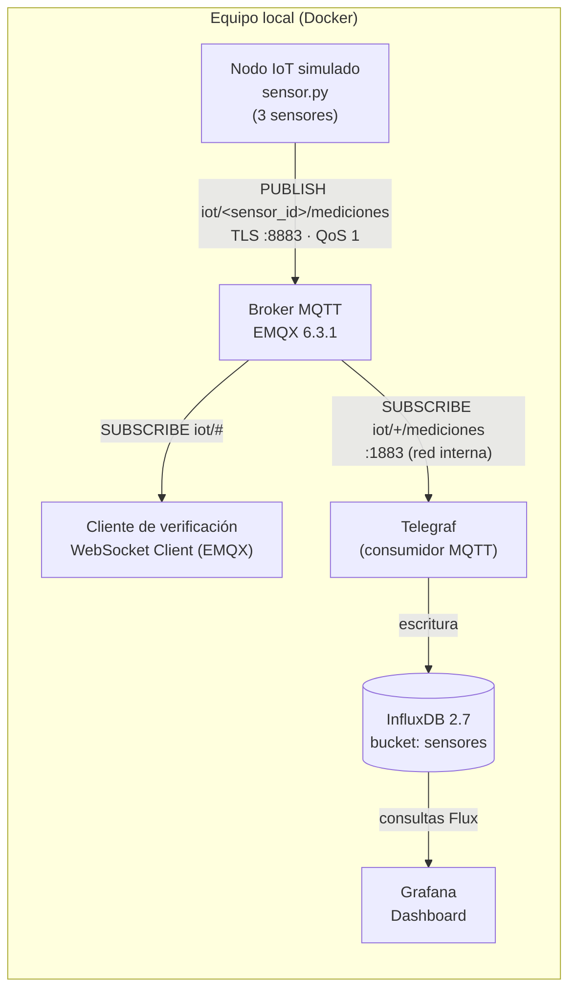
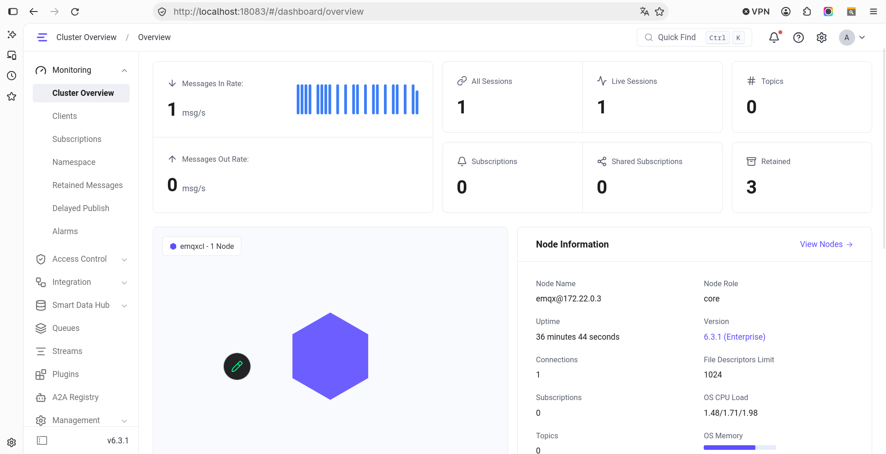
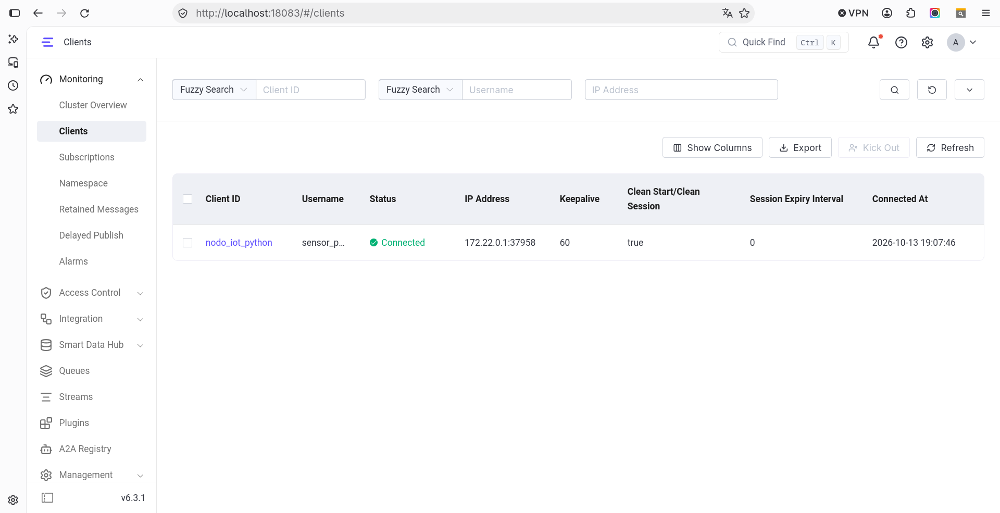
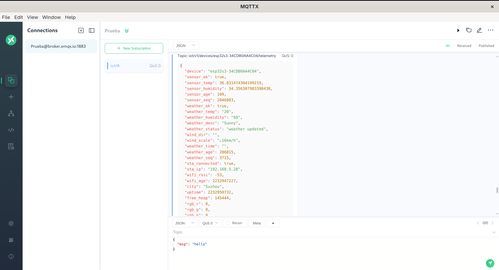
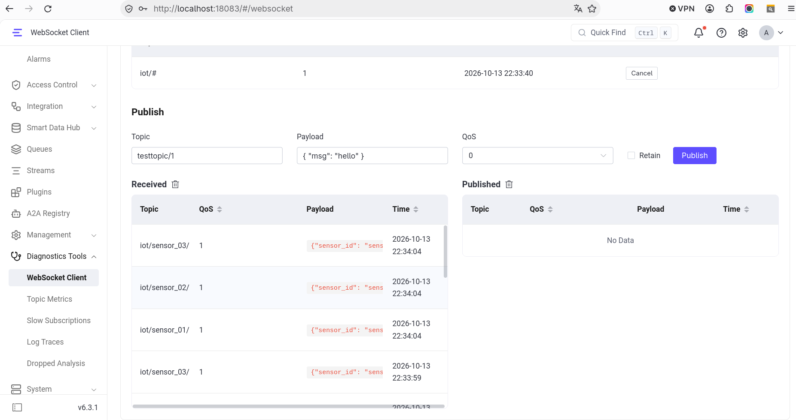
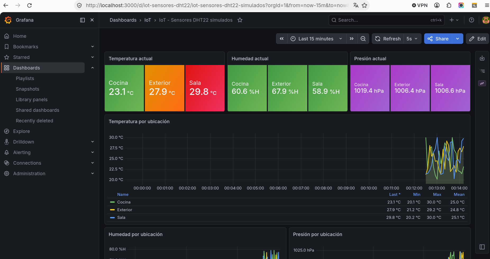
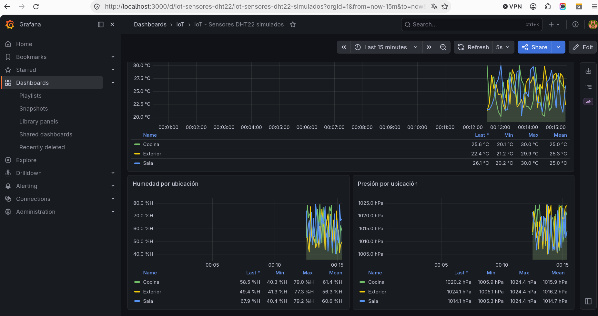

# Informe – Laboratorio U3: Nodo IoT simulado con MQTT y EMQX

## 1. Objetivo

Implementar una arquitectura IoT funcional que reproduzca el flujo básico **adquisición de datos → transmisión MQTT → visualización y verificación**, cumpliendo los objetivos específicos de la práctica:

- Simular un nodo IoT en Python que genere lecturas de un sensor tipo DHT22.
- Transmitir los datos mediante el protocolo MQTT hacia un broker local EMQX desplegado con Docker.
- Verificar la transmisión de datos con clientes MQTT (MQTTX y el WebSocket Client integrado en EMQX).
- Aplicar las recomendaciones adicionales de la guía: timestamp, múltiples sensores, seguridad (autenticación y TLS/SSL) y visualización con Grafana.

## 2. Arquitectura



| Componente | Función | Puerto |
|------------|---------|--------|
| `sensor.py` | Genera y publica lecturas cada 5 s | — |
| EMQX | Broker MQTT: recibe y distribuye los mensajes | 1883 (MQTT), 8883 (MQTT/TLS), 8083 (WebSocket), 18083 (panel) |
| Telegraf | Se suscribe al broker y guarda cada lectura en la base de datos | — |
| InfluxDB | Base de datos de series de tiempo | 8086 |
| Grafana | Visualización de las lecturas | 3000 |

Cada sensor publica un mensaje JSON en el tópico `iot/<sensor_id>/mediciones`:

```json
{
  "sensor_id": "sensor_01",
  "ubicacion": "Sala",
  "temperatura": 22.11,
  "humedad": 52.31,
  "presion": 1020.57,
  "timestamp": "2026-10-13T23:51:50.490004+00:00"
}
```

## 3. Desarrollo por etapa

### Etapa 1: Implementación del nodo IoT con datos simulados

Se desarrolló `sensor-dht22-simulado/sensor.py` a partir del código de referencia de la guía, ampliándolo con:

- **Tres sensores simulados** (Sala, Cocina y Exterior) en lugar de uno.
- **Tres variables** por lectura: temperatura (20–30 °C), humedad (40–80 %) y presión (1005–1025 hPa).
- **Timestamp** en formato ISO 8601 (UTC) generado en el momento de la lectura.
- **Formato JSON** y publicación con **QoS 1** (entrega garantizada al menos una vez).
- Configuración externa mediante archivo `.env` (host, puerto, TLS, usuario y contraseña), de modo que no es necesario modificar el código para cambiar de entorno.

Las dependencias (`paho-mqtt`, `python-dotenv`) se instalan en un entorno virtual con `pip install -r requirements.txt`.

### Etapa 2: Despliegue del broker MQTT con EMQX en Docker

El broker se definió en `broker/docker-compose.yml` y se levanta con:

```bash
docker compose up -d
docker ps
```

Se fijó la versión `emqx/emqx:6.3.1` y se añadió un volumen persistente (`emqx_data`) para conservar usuarios y configuración entre reinicios. El panel de administración quedó disponible en `http://localhost:18083`, donde se cambió la contraseña por defecto del usuario `admin`.



*Figura 1. Panel de EMQX (Cluster Overview): nodo activo, una sesión conectada y tasa de mensajes entrantes.*



*Figura 2. Monitoring → Clients: el nodo IoT conectado y autenticado con el usuario `sensor_python`.*

### Etapa 3: Verificación de la transmisión de datos

La verificación se realizó con dos clientes MQTT suscritos al tópico comodín `iot/#`:

**1. MQTTX (cliente de escritorio).** Primero se utilizó MQTTX para familiarizarse con el funcionamiento de un cliente MQTT: crear una conexión, suscribirse a un tópico con comodín y visualizar mensajes en formato JSON. Para esta prueba se conectó al broker público de EMQX (`broker.emqx.io:1883`), donde se reciben mensajes de dispositivos de terceros publicados bajo `iot/...`.



*Figura 3. MQTTX conectado al broker público `broker.emqx.io` y suscrito a `iot/#`: recepción de un mensaje JSON de telemetría de un dispositivo externo (ESP32).*

**2. WebSocket Client de EMQX (broker local).** La verificación de los datos de nuestro nodo IoT se realizó con el *WebSocket Client* integrado en el panel de EMQX (*Diagnostics Tools*), conectado a `localhost` por el puerto 8083 con el usuario `explorer`. En la sección *Received* se observan los mensajes JSON de los tres sensores llegando cada 5 segundos.



*Figura 4. WebSocket Client de EMQX conectado a `localhost` y suscrito a `iot/#`: mensajes de `sensor_01`, `sensor_02` y `sensor_03` con QoS 1.*

### Etapa 4: Recomendaciones adicionales

Además de la seguridad (sección 4), se implementaron las extensiones sugeridas por la guía:

- **Timestamp y múltiples sensores**, descritos en la Etapa 1.
- **Almacenamiento y visualización con Grafana.** Se añadieron al `docker-compose.yml`:
  - **Telegraf**, que se suscribe a `iot/+/mediciones` y escribe cada lectura en InfluxDB conservando el timestamp original del sensor. `sensor_id` y `ubicacion` se guardan como etiquetas y las tres variables como campos numéricos.
  - **InfluxDB 2.7** como base de datos de series de tiempo (organización `iot`, bucket `sensores`).
  - **Grafana 13**, con la fuente de datos y el dashboard cargados automáticamente al iniciar (*provisioning*), sin configuración manual.

El dashboard *IoT – Sensores DHT22 simulados* muestra el valor actual de cada variable por ubicación y su evolución en el tiempo, con mínimo, máximo y promedio, actualizándose cada 5 segundos.



*Figura 5. Dashboard de Grafana: valores actuales de temperatura, humedad y presión por ubicación, y gráfica de temperatura.*



*Figura 6. Gráficas de humedad y presión por ubicación con sus estadísticas.*

## 4. Seguridad: TLS y autenticación

Siguiendo las recomendaciones de la guía, se protegió el broker en dos niveles.

**Autenticación por usuario y contraseña.** En EMQX (*Access Control → Authentication*) se creó un autenticador *Password-Based* con base de datos interna y un usuario por cliente:

| Usuario | Cliente |
|---------|---------|
| `sensor_python` | Nodo IoT (`sensor.py`) |
| `telegraf` | Telegraf (puente hacia InfluxDB) |
| `explorer` | Cliente de verificación (WebSocket Client) |

Las contraseñas se guardan en archivos `.env` excluidos del repositorio, y en su lugar se versionan plantillas `.env.example`.

**Cifrado TLS/SSL.** El listener del puerto **8883** utiliza certificados propios del laboratorio: una autoridad certificadora (`ca.crt`) y un certificado de servidor para `localhost` (`server.crt` / `server.key`). El nodo IoT se conecta por este puerto validando el certificado del broker contra la CA (`CERT_REQUIRED`).

**Pruebas realizadas:**

| Prueba | Resultado esperado | Resultado obtenido |
|--------|--------------------|--------------------|
| Cliente anónimo en 1883 | Rechazado | `Not authorized` ✔ |
| Cliente anónimo en 8883 (TLS) | Rechazado | `Not authorized` ✔ |
| `sensor_python` con contraseña incorrecta | Rechazado | `Bad user name or password` ✔ |
| `sensor_python` con credenciales correctas por TLS | Conectado | Conectado ✔ |
| Verificación del certificado (`openssl s_client`) | Certificado válido | `Verify return code: 0 (ok)` ✔ |

El puerto 1883 sin cifrar se mantuvo para el laboratorio (uso de Telegraf dentro de la red interna de Docker y de clientes de prueba); en un entorno productivo se cerraría y solo se expondría el 8883.

## 5. Problemas encontrados y soluciones

| # | Problema | Causa | Solución |
|---|----------|-------|----------|
| 1 | El sensor mostraba "Publicando…" pero ningún mensaje llegaba al broker | Las líneas `client.connect()` y `client.loop_start()` estaban comentadas | Se reactivó la conexión y se añadió un callback `on_connect` que informa si la conexión fue exitosa o rechazada |
| 2 | El contenedor de EMQX no podía leer los certificados (`Permission denied`) | La ruta del volumen era incorrecta (`../certs`) y SELinux (Fedora) bloquea el acceso a carpetas del usuario | Se corrigió la ruta a `./certs` y se añadió la opción `:z` al volumen, que se ignora en Windows/macOS |
| 3 | El nodo IoT se desconectaba y reconectaba continuamente | Dos instancias de `sensor.py` usaban el mismo `client_id`; MQTT solo admite una sesión por identificador y expulsa a la anterior | Se generó un `client_id` único por ejecución (`nodo_iot_python_<aleatorio>`), configurable por variable de entorno |
| 4 | El panel de EMQX era distinto al de la guía | La imagen `emqx/emqx:latest` descargó la versión 6.3.1, con una interfaz diferente a la 5.x de la guía | Se fijó la versión en el `docker-compose.yml` para que el entorno sea reproducible para todo el grupo |
| 5 | Los usuarios y la contraseña de EMQX se perdían al recrear el contenedor | EMQX no tenía un volumen para sus datos | Se añadió el volumen persistente `emqx_data` |
| 6 | Telegraf no podía suscribirse (`not Authorized`) | Al activar la autenticación, todos los clientes necesitan credenciales | Se creó el usuario `telegraf` en EMQX y su contraseña se pasa desde `broker/.env` |

## 6. Conclusiones

- Se implementó y verificó el flujo completo de una solución IoT: el nodo simulado genera lecturas, las publica por MQTT, el broker EMQX las distribuye a los suscriptores y finalmente se almacenan en InfluxDB y se visualizan en Grafana.
- El modelo **publicación/suscripción** de MQTT desacopla a productores y consumidores: el nodo IoT no conoce a sus suscriptores, y fue posible añadir el WebSocket Client y Telegraf como suscriptores sin modificar el sensor. El uso de tópicos jerárquicos (`iot/<sensor_id>/mediciones`) y comodines (`#`, `+`) permite suscribirse a uno o a todos los sensores.
- **Docker** facilitó desplegar todos los servicios con un único comando y de forma reproducible; fijar las versiones de las imágenes evitó diferencias entre los equipos del grupo.
- La seguridad no viene activada por defecto: EMQX acepta conexiones anónimas y sin cifrar hasta que se configuran la autenticación y TLS. Ambas medidas son imprescindibles en un entorno real, al igual que mantener las credenciales fuera del código fuente.
- Los datos simulados permiten validar toda la arquitectura sin hardware; reemplazarlos por un sensor DHT22 físico en una Raspberry Pi solo requeriría cambiar la función de lectura, manteniendo el mismo formato de mensaje y el resto del flujo.
